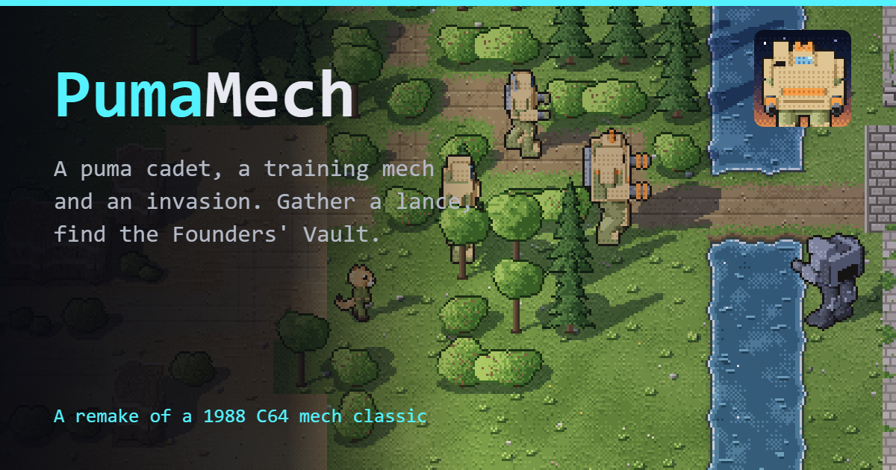

# PumaMech

**The Sunclaws Rise.** A remake of *BattleTech: The Crescent Hawk's Inception* (Westwood Associates for Infocom, 1988; Commodore 64, 1989): a puma cadet, a borrowed training mech, and an invasion. Everything in it -- the world, the mechs, the people and every word -- is our own; only the shape of the game is the 1988 one.

## Play

[greykit.com/games/pumamech](https://greykit.com/games/pumamech/)

No install required. Plain scripts, no build step, nothing fetched at play time: every picture is drawn and every sound synthesised in the page; the two typefaces ship with it.

## How it plays

You are a third-year cadet at the **Bastion**, the mech academy of Pardalis, and the commander's child. Take lessons in the Training Hall (Gunnery, Piloting, Small arms, Melee, Tech, Medic: three lessons before graduation, spent as you like; each recruit gets two once you retake the Bastion), then fly three sorties in your **Tabby** trainer from the Hangar. The third is the graduation run. It is also the morning the **Grey Pact** lands.

Then you are on your own in an occupied world: **Portgate** and its Pact-held spaceport, **Fernwick** in the woods, **Kiln Hollow** in the badlands, and the snow of the **High Spurs**. Walk the map a tile at a time. Walk into a door to go in and into someone to talk. Towns have inns to rest and save, shops, a mech yard, a bank with a **stock exchange** whose prices move every morning and hard on the news, a gym, a clinic, and people with something to say. In the wilds you will be found: by scrub drakes, stoat raiders, and the Pact's patrols and lances.

Gather a lance of misfits: Pip the raccoon cadet, Mags the bear mercenary, Bracken the fox mech wright, Wren the otter surgeon, Quill the hare scout. Up to six people and four mechs travel together. Your father left word at the **Relay**; Brock, the last of the Founders' Guard, has a locator and a code card. Somewhere in the High Spurs is the **Founders' Vault**, its doors sealed by red, blue and yellow codes, with a deep-signal array that can call the Concord Fleet, and three mechs older than the colony.

### Fights

Fights are **rounds of orders**, as in 1988. For each of your people and mechs: a route (walk, run, or jump; several legs if you like, and what is plotted past this round's reach carries into the next), then a target for **each weapon**, and maybe a kick or punch, a satchel charge, a medkit, or cover. Then the round plays out in twelve steps, everyone moving at once, and **every weapon fires on its own**: at the first step its target is inside its short range, or, if that never comes, at its best chance of the round. Getting close is how you get the good shots. Moving is defence: the further a unit goes in a round, the harder it is to hit and the worse it aims. Aims hold from round to round until the target is gone.

- Mechs are hit in a **location** (head, torsos, arms, legs): armour first, then the frame. Shoot a location away and its weapons go with it. A head or a centre torso shot through finishes a mech; your pilot ejects and fights on foot.
- Weapons and running make **heat**; the sinks shed some each round, more standing in water. A hot mech aims worse, walks slower, and shuts down.
- Beat a mech without blowing it apart -- its pilot ejects, or its legs go -- and you **salvage** it: it is hauled to the yard, to repair and pilot, or to sell.
- Your Tech patches armour after a fight, your Medic dresses wounds, and everyone learns a little from what they did.

### Keys

| | |
|---|---|
| Arrows, WASD | walk; in a fight, move the cursor |
| `Enter`, `Space` | talk, choose; in a fight, lay a leg or aim everything, and finish a step |
| `P` `J` `Tab` | the party, the journal, the map |
| `Esc` | the menu; in a fight, back a step |
| `M` | sound |
| In a fight | `R` run, `J` jump, `Backspace` clear the route, `Tab` next enemy, `1`-`9` one weapon on it, `0` hold fire, `K` kick, `U` punch, `X` satchel, `H` medkit, `D` cover, `A` let the unit decide, `G` fight the round, `Q` retreat |

The mouse works in a fight (hover moves the cursor, a click chooses). A gamepad works too. It is a desktop game: on a phone or a small window the page says so instead.

## What's in here

| | |
|---|---|
| `index.html` | the page: the 480×300 field, the title, the note for small screens |
| `css/gk-tokens.css` | the Tactical palette, byte for byte from games-meta `canon/` (STANDARD.md §4) |
| `css/pumamech.css` | the page, the HUD and every sheet: flat dark panels over the field (Airborne Puma's) |
| `fonts/` | Barlow Semi Condensed and Pixelify Sans (SIL Open Font License; the licences are beside them) |
| `js/gk-title.js` | the greykit.games boot, byte for byte from games-meta `canon/` (§3); the title after it is the game's own, in `js/main.js` |
| `js/data.js`, `js/world.js`, `js/story.js` | the tables (weapons, chassis, kit, cast, foes, the Exchange), the world of Pardalis and the Vault, the plot |
| `js/engine/*.js` | the game itself, with no DOM in it: state and saves, walking and encounters, the battle rules, the enemy's mind |
| `js/kit.js`, `js/ground.js`, `js/things.js`, `js/people.js` | Airborne Puma's art kit, ground, installations and people, carried over; `people.js` gains the peoples of Pardalis |
| `js/town.js`, `js/buildings.js`, `js/mechs.js` | paving, roads, the bridge, fields and the Vault's floors; buildings in four towns' styles; the mechs and creatures, each a small 3D model rendered to pixel art at eight headings |
| `js/render.js`, `js/hud.js`, `js/ui.js`, `js/screens.js`, `js/places.js`, `js/battle.js` | the field, the panels, the sheets, the sheets that are places, and the fight on screen |
| `js/sfx.js`, `js/main.js` | Web Audio (effects and the title march), and boot, title, the walk and the loop |
| `tools/sim-check.js` | headless: battles end and replay the same from the same seed; every door, town and the Vault can be walked to; the Vault's doors are solvable |
| `tools/playthrough.js` | headless: the story stage by stage, walked with the game's own step; every door, person and Vault fitting can be reached by a way the player can see (not under a roof, a Vault wall's top, or through people and parked mechs) |
| `tools/balance.js` | headless: how often the AI wins the fights the story deals out (for tuning) |
| `tools/stamp-assets.js`, `tools/check-assets.js` | content hashes on every script and stylesheet URL; every file the page names exists (games-meta §10) |
| `tools/make-icons.js`, `tools/og.html`, `tools/icon-art.json` | the icons and the share card, from the game's own sprites |
| `tools/preview.html`, `tools/openspots.js` | a sprite sheet for the art, and where on the map a fight has room |

`?quick=1` on the page starts a new game at once, for testing; add `&invaded=1` to skip the academy, `&lance=1` for three mechs and three recruits, `&money=n`, `&at=x,y`, or `&vault=1`.

## Saves

Everything is in `localStorage` under keys starting `pumamech_`: the last save (the game saves itself when you rest, enter a town, or win a fight), three save slots, settings and sound. Settings → *Forget everything* clears exactly those.

## Not included

The original disks may sit beside this repo for reference. They are their owners', they are gitignored, and nothing of theirs -- code, art, sound, text, names -- is in this game.

## License

MIT. See [LICENSE](LICENSE).
